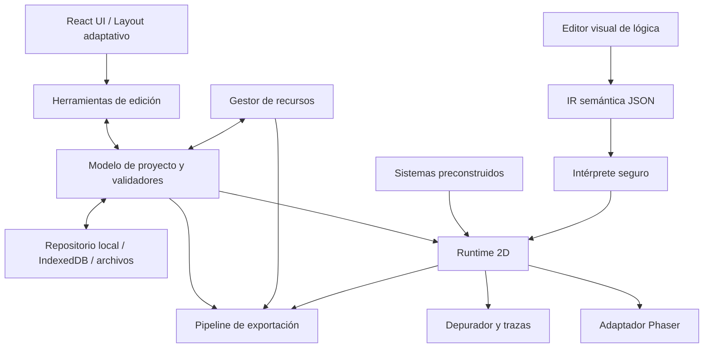
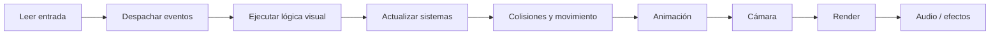
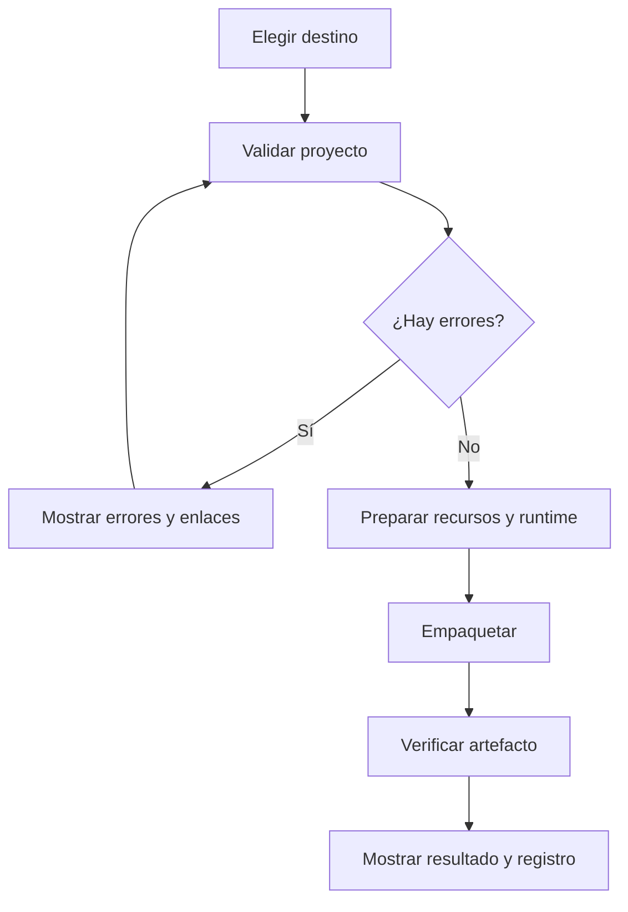

# PixelForge 2D — Especificación Maestra del Producto y Técnica

**Archivo:** `PixelForge2D_Master_Spec.md`  
**Versión de la especificación:** 1.1.0  
**Estado:** Base de diseño para implementación  
**Idioma del producto y de esta especificación:** Español  
**Plataformas objetivo iniciales:** escritorio y Android; runtime Web como destino de exportación  
**Principio rector:** crear videojuegos 2D completos mediante herramientas visuales, sin exigir que el usuario escriba código.

---

## 0. Cómo utilizar esta especificación

Este documento es la referencia funcional y técnica principal para construir PixelForge 2D. Las decisiones aquí descritas son la línea base. Cuando una decisión dependa de una prueba técnica o de una capacidad real de una plataforma, se marca como **ADR pendiente de validar** y no debe presentarse como función terminada.

Convenciones:

- **MUST / DEBE:** requisito obligatorio.
- **SHOULD / DEBERÍA:** recomendación fuerte; cualquier excepción debe documentarse.
- **MAY / PUEDE:** capacidad opcional.
- **MVP:** primera versión vertical y funcional, no una colección de pantallas simuladas.
- **Editor:** aplicación de autoría.
- **Runtime:** entorno que ejecuta los juegos creados.
- **Proyecto:** documento portable que contiene escenas, objetos, lógica y recursos.
- **Juego exportado:** paquete ejecutable independiente del editor.

### Principios no negociables

1. El flujo normal de creación no requiere escribir código.
2. Los bloques representan operaciones semánticas propias de PixelForge, no fragmentos de JavaScript.
3. El runtime valida y ejecuta instrucciones de una lista permitida; nunca ejecuta código arbitrario de proyectos.
4. Editor, modelo de proyecto y runtime están separados por contratos versionados.
5. Los proyectos locales se pueden crear, editar, probar y guardar sin conexión.
6. PC y Android son superficies de edición reales. Android no es un visor limitado.
7. La interfaz comienza en español y usa tema oscuro.
8. Las plantillas y prefabricados son editables; no son escenas cerradas ni imágenes decorativas.
9. Ninguna plataforma de exportación se declara compatible hasta superar una prueba de empaquetado, instalación/ejecución y regresión.
10. La arquitectura será un monolito modular: límites claros, pocos paquetes y sin microservicios.

---

# 1. Resumen ejecutivo

PixelForge 2D es un editor visual multiplataforma para crear videojuegos 2D, con especial atención a aventuras top-down de estética pixel art. Su público abarca principiantes que necesitan construir juegos sin programar y usuarios avanzados que desean lógica visual expresiva, herramientas de edición precisas y sistemas reutilizables.

La aplicación integra:

- Editor modular de escenas y mapas por tiles.
- Editor de pixel art, spritesheets y animaciones.
- Programación visual sencilla y avanzada.
- Objetos manuales y prefabricados funcionales.
- Sistemas configurables de diálogo, inventario, combate, misiones, tiendas y guardado.
- Audio, partículas, cámaras, generación procedural y depuración.
- Biblioteca local y catálogo online opcional de recursos.
- Importación/exportación portable mediante ZIP.
- Exportación inicial a Web y, después de validación, Android.
- Asistente de IA opcional con cambios revisables.

La arquitectura recomendada es **TypeScript + React + Phaser 3 + almacenamiento local IndexedDB**, con una capa de abstracción del modelo del proyecto y un intérprete propio de lógica visual. Blockly puede evaluarse como superficie de edición de bloques, pero no será el formato de ejecución ni la fuente de verdad. Capacitor puede proporcionar el contenedor Android del editor; no sustituye el trabajo específico de rendimiento, almacenamiento, ciclo de vida y exportación.

La primera entrega no intentará abarcar todas las funciones. El MVP será un juego pequeño completo: dos escenas, personaje controlable, colisiones, un cofre interactivo con diálogo/recompensa, transición de escena, guardado y exportación Web de prueba. El objetivo es demostrar un flujo real de creación a ejecución antes de ampliar el producto.

---

# 2. Visión, objetivos y límites

## 2.1 Visión

Hacer que la creación de juegos 2D sea accesible sin sacrificar profundidad. La complejidad se presenta progresivamente: primero acciones y formularios claros; después condiciones, variables, eventos, nodos y depuración avanzada.

## 2.2 Objetivos de producto

- Permitir crear un prototipo jugable sin escribir código.
- Cubrir el ciclo completo: crear proyecto → diseñar recursos → construir escenas → configurar lógica → probar → guardar → exportar.
- Mantener un modelo portable y legible.
- Permitir trabajar offline.
- Facilitar la reutilización mediante prefabricados, plantillas y packs.
- Mantener una experiencia consistente en PC, tablets y teléfonos.
- Evitar dependencias de servicios online para las tareas esenciales.

## 2.3 No objetivos iniciales

- Motor 3D.
- Multijugador en tiempo real o networking autoritativo.
- Marketplace con pagos dentro de la aplicación.
- Lenguaje de scripting obligatorio.
- Compatibilidad universal con cualquier formato de proyecto externo.
- Exportación nativa a todas las consolas o tiendas móviles.
- Editor de música profesional multipista.
- IA generativa integrada como requisito para trabajar.

Estas posibilidades podrán estudiarse en el futuro, pero no deben retrasar el MVP.

## 2.4 Usuarios y niveles de experiencia

| Nivel | Necesidad | Experiencia |
|---|---|---|
| Inicial | Crear algo jugable con poca configuración | Asistentes, plantillas, inspector guiado, bloques básicos |
| Intermedio | Personalizar mecánicas y escenas | Variables, condiciones, eventos, prefabricados |
| Avanzado | Crear sistemas complejos reutilizables | Funciones visuales, listas, estados, nodos, depurador |

La aplicación no debe bloquear funciones avanzadas por nivel. El modo progresivo organiza la interfaz, no limita artificialmente el proyecto.

## 2.5 Métricas de éxito

- Un usuario nuevo crea y prueba una escena con movimiento y colisiones en menos de 15 minutos usando una plantilla.
- El MVP completo puede construirse sin abrir un editor de código.
- Un proyecto puede cerrarse, reabrirse y conservar el mismo estado de edición.
- La exportación Web reproduce el juego sin depender del editor.
- El 100 % de los botones visibles del MVP tiene una acción funcional o se muestra explícitamente deshabilitado con explicación.
- Los errores de validación identifican archivo, objeto o bloque y sugieren una corrección.

---

# 3. Requisitos funcionales

## 3.1 Matriz de módulos

| ID | Módulo | Capacidades principales | Dependencias |
|---|---|---|---|
| PF-001 | Gestión de proyectos | Crear, abrir, duplicar, importar, exportar, recuperar | Modelo, almacenamiento |
| PF-002 | Editor de escenas | Jerarquía, viewport, selección, transformaciones | Modelo, runtime preview |
| PF-003 | Mapas y tilesets | Pintado, capas, colisiones, regiones, minimapa | Recursos, escenas |
| PF-004 | Autotiling | Reglas 4/8 vecinos, transiciones y validación | Tilesets, mapa |
| PF-005 | Pixel art | Herramientas raster, paletas, PNG, historial | Recursos |
| PF-006 | Animación | Frames, tiempos, spritesheets, direcciones | Sprites |
| PF-007 | Lógica visual | Eventos, acciones, condiciones, variables | Intérprete |
| PF-008 | Prefabricados | Crear, instanciar, parametrizar y actualizar | Objetos, recursos, lógica |
| PF-009 | Diálogos | Grafos de conversación y consecuencias | Lógica, UI |
| PF-010 | Inventario/equipamiento | Slots, stacks, objetos y eventos | Datos, UI |
| PF-011 | Combate | Vida, daño, habilidades, estados, IA simple | Lógica, colisiones |
| PF-012 | Misiones | Requisitos, objetivos, progreso y recompensas | Variables, eventos |
| PF-013 | Tiendas/economía | Catálogo, precios, compra/venta | Inventario, monedas |
| PF-014 | Audio | Importación, buses, eventos, loop, fades | Recursos, eventos |
| PF-015 | Partículas | Emisión y parámetros visuales | Runtime, recursos |
| PF-016 | Cámara | Follow, límites, zoom, shake, parallax | Escenas |
| PF-017 | Guardado | Slots, autosave, checkpoints, migraciones | Runtime, modelo |
| PF-018 | Depurador | Pausa, paso, variables, eventos, trazas | Runtime, intérprete |
| PF-019 | Procedural | Generación por parámetros y semilla | Mapas, tilesets |
| PF-020 | Biblioteca | Packs locales/online, licencias, metadatos | Red opcional |
| PF-021 | IA opcional | Sugerencias revisables | Proveedor externo opcional |
| PF-022 | Plugins | Manifiestos, permisos, compatibilidad | API de extensiones |
| PF-023 | Exportación | Web, ZIP y Android validado | Runtime, empaquetadores |
| PF-024 | Mandos | Mapeo de entradas y prueba | Input abstraction |
| PF-025 | UX multiplataforma | Layouts adaptativos, gestos y accesibilidad | Todos |

## 3.2 Requisitos transversales

- Todas las entidades persistentes tienen ID estable.
- Cambios destructivos importantes solicitan confirmación y ofrecen deshacer cuando sea viable.
- Las operaciones del editor deben poder deshacerse/rehacerse.
- Los errores de validación se muestran en español y enlazan al elemento afectado.
- El usuario puede guardar en cualquier momento.
- El editor debe recuperar una sesión tras cierre inesperado mediante autosave/diario de cambios.
- Los sistemas preconstruidos exponen propiedades en inspector y eventos documentados.
- Las funciones que requieren conexión indican claramente que están online.

---

# 4. Requisitos no funcionales

| Área | Requisito objetivo inicial |
|---|---|
| Rendimiento editor | Interacciones comunes a 60 FPS en equipos de referencia; degradación controlada en móviles modestos |
| Renderizado juego | Objetivo 60 FPS; opción 30 FPS para ahorro energético |
| Carga | Abrir un proyecto pequeño de prueba en menos de 5 s en equipo de referencia |
| Recuperación | Recuperar autosave posterior al último guardado confirmado |
| Offline | Crear/editar/probar/guardar/exportar proyecto local sin red |
| Portabilidad | ZIP sin rutas absolutas ni dependencias de caché |
| Seguridad | No evaluar scripts arbitrarios de proyectos ni plugins sin sandbox |
| Accesibilidad | Navegación por teclado, foco visible, escalado de interfaz y etiquetas |
| Mantenibilidad | TypeScript estricto, módulos documentados, pruebas automatizadas |
| Compatibilidad | Versiones de esquema declaradas y migraciones verificadas |
| Internacionalización | Español inicial; textos centralizados para traducción futura |

Los valores son objetivos de ingeniería, no garantías universales. Deben medirse en hardware de referencia documentado.

---

# 5. UX/UI y sistema de interacción

## 5.1 Estructura general del editor

En escritorio:

```text
┌────────────────────────────────────────────────────────────────────┐
│ Menú / Proyecto / Deshacer / Rehacer / Guardar / Play / Exportar   │
├───────────────┬────────────────────────────────┬───────────────────┤
│ Biblioteca /  │                                │ Inspector         │
│ Jerarquía     │         Viewport central       │ Propiedades       │
│ Capas         │         Escena / mapa          │ Componentes       │
├───────────────┴────────────────────────────────┴───────────────────┤
│ Panel inferior: Bloques / Consola / Errores / Recursos / Timeline  │
└────────────────────────────────────────────────────────────────────┘
```

Los paneles son acoplables, redimensionables, plegables y restaurables. El usuario puede guardar distribuciones de paneles por espacio de trabajo.

## 5.2 Android y tablets

- Barra superior compacta con proyecto, guardar y ejecutar.
- Navegación inferior para áreas principales: Escena, Recursos, Lógica, Animación y Proyecto.
- Inspector en panel modal inferior o lateral según tamaño.
- Herramientas esenciales accesibles con una mano cuando sea posible.
- Gestos: pellizcar para zoom, arrastrar con dos dedos para desplazar, toque para seleccionar, pulsación prolongada para menú contextual.
- Los gestos no deben ser la única forma de ejecutar una acción: debe existir alternativa mediante botones.
- Soporte de stylus cuando el dispositivo lo permita.
- Teclado físico y mouse se reconocen en tablets.
- El modo paisaje se recomienda para edición de mapas; retrato debe permitir operaciones esenciales.

## 5.3 Diseño visual

- Tema oscuro predeterminado con contraste suficiente.
- Colores semánticos consistentes: selección, advertencia, error, ejecución y deshabilitado.
- Iconos acompañados por tooltip o etiqueta en acciones poco conocidas.
- Densidad adaptable: compacta en escritorio, táctil en móvil.
- Herramientas frecuentes visibles; parámetros avanzados en secciones plegables.
- No ocultar el estado de guardado, conexión, ejecución o errores.

## 5.4 Flujos principales

### Crear un proyecto

1. Elegir plantilla o proyecto vacío.
2. Introducir nombre y ubicación.
3. Elegir resolución lógica, orientación y escala.
4. Crear escenas iniciales.
5. Abrir editor con guía contextual opcional.

### Crear un personaje

1. Crear objeto desde plantilla o manualmente.
2. Asignar sprite o crear uno en el editor.
3. Definir animaciones y direcciones.
4. Añadir componente de movimiento.
5. Configurar colisión y punto de origen.
6. Elegir controles.
7. Probar en viewport.

### Crear un cofre interactivo

1. Arrastrar prefabricado “Cofre”.
2. Ajustar posición y apariencia.
3. Editar zona de interacción.
4. Configurar recompensa.
5. Editar diálogo o texto de interacción.
6. Probar abrir/cerrar y persistencia.
7. Guardar prefabricado personalizado si se desea.

### Publicar

1. Seleccionar destino disponible.
2. Ejecutar validación.
3. Revisar errores y advertencias.
4. Configurar nombre, icono y opciones del paquete.
5. Generar artefacto.
6. Mostrar ubicación, registro y pasos siguientes.

---

# 6. Arquitectura técnica

## 6.1 Decisión recomendada

| Capa | Tecnología inicial | Motivo |
|---|---|---|
| UI | React + TypeScript | Ecosistema amplio, componentes y experiencia multiplataforma |
| Estado | Zustand o Redux Toolkit (elegir uno) | Estado explícito; evitar duplicar fuentes de verdad |
| Editor gráfico | Canvas 2D/WebGL según herramienta | Control sobre viewport y herramientas |
| Runtime 2D | Phaser 3 | Adecuado para juegos 2D y exportación Web |
| Bloques | UI propia o Blockly como adaptador | Modelo semántico independiente |
| Persistencia web | IndexedDB vía Dexie o repositorio propio | Proyectos y recursos locales |
| Archivos | File System Access API donde exista; selector/copia en otros entornos | Capacidades variables entre navegadores |
| Android editor | Capacitor | Empaquetado de aplicación web y plugins nativos |
| Validación | Zod o Valibot | Validación de contratos JSON |
| Pruebas | Vitest + Playwright; pruebas Android instrumentadas | Cobertura de lógica y flujos |
| Empaquetado | ZIP mediante biblioteca mantenida | Proyecto portable |

**ADR-001 — Phaser 3:** adoptarlo como runtime inicial, no como formato de proyecto. Encapsularlo tras interfaces `RendererAdapter`, `InputAdapter`, `AudioAdapter` y `SceneRuntimeAdapter`. Así se evita que el modelo de datos dependa de clases de Phaser.

**ADR-002 — Blockly:** puede utilizarse como editor visual inicial si acelera la entrega, pero los bloques deben tener IDs semánticos de PixelForge y serializarse al formato propio. No generar JavaScript para ejecutar proyectos. Si la integración complica móvil o accesibilidad, implementar un editor de nodos propio sobre una biblioteca de canvas.

**ADR-003 — Monolito modular:** una aplicación y un repositorio principal, separados por módulos y contratos. No crear microservicios para una aplicación local-first.

## 6.2 Diagrama de componentes



## 6.3 Límites entre módulos

Cada módulo es una **carpeta dentro de `src/`** del proyecto único (no un paquete independiente).

- `project-model`: tipos, IDs, validación, migración y serialización.
- `editor`: interfaz, selección, herramientas, paneles, comandos y undo/redo.
- `visual-logic`: catálogo de nodos, grafo, validación, serialización e intérprete.
- `runtime`: ciclo de vida, entidades, eventos, sistemas y adaptadores.
- `asset-pipeline`: importación, miniaturas, metadatos y referencias.
- `built-in-systems`: diálogo, inventario, combate, misiones, tiendas, partículas, cámara.
- `storage`: repositorios, autosave, backups y ZIP.
- `exporters`: validación y empaquetadores.
- `platform`: capacidades de escritorio, web y Android.
- `extensions`: API y permisos.

Evitar que un módulo importe detalles internos de otro. La comunicación debe realizarse mediante tipos públicos y eventos/servicios explícitos.

## 6.4 Organización sugerida del repositorio

**Decisión confirmada: proyecto único con carpetas organizadas. NO usar monorepo** (ni pnpm workspaces ni paquetes separados). Hay un solo `package.json` en la raíz.

```text
pixelforge-2d/
├── src/
│   ├── editor/                 # interfaz React, paneles, herramientas, undo/redo
│   ├── model/                  # modelo de proyecto, IDs, validación, migraciones
│   ├── logic/                  # catálogo de nodos, grafo e intérprete seguro
│   ├── runtime/                # runtime 2D y adaptador de Phaser
│   ├── systems/                # diálogo, inventario, combate, misiones, tiendas
│   ├── assets/                 # importación y gestión de recursos
│   ├── storage/                # almacenamiento local, autosave, ZIP
│   ├── exporters/              # exportación Web (y Android en fase posterior)
│   ├── platform/               # capacidades de escritorio, web y Android
│   └── ui/                     # componentes visuales compartidos
├── public/                     # archivos estáticos
├── templates/                  # plantillas de proyecto
├── starter-assets/             # recursos originales de ejemplo
├── docs/
├── tests/
├── scripts/
├── package.json
├── PixelForge2D_Master_Spec.md
└── README.md
```

Las carpetas de `src/` se crean cuando exista una responsabilidad real, no el primer día. Si en el futuro el proyecto crece mucho, se podrá migrar a monorepo mediante un ADR.

La carpeta `android/` de Capacitor se añade solo en la fase del editor Android.

---

# 7. Modelo de proyecto y datos

## 7.1 Reglas de modelado

- IDs UUID o ULID, generados al crear entidades.
- Referencias mediante ID, nunca por nombre visible.
- Nombres editables y no necesariamente únicos.
- Coordenadas de mundo en unidades lógicas; conversión a píxeles en adaptadores.
- Datos serializables sin instancias de clases del motor.
- Campos desconocidos de versiones futuras no deben destruirse durante una lectura compatible cuando sea posible.
- Todas las entidades incluyen `id`, `name` y `schemaVersion` cuando corresponda.

## 7.2 Entidades principales

```ts
type Id = string;

interface Project {
  id: Id;
  name: string;
  schemaVersion: string;
  editorVersion: string;
  createdAt: string;
  updatedAt: string;
  settings: ProjectSettings;
  sceneIds: Id[];
  startSceneId: Id;
  assetIds: Id[];
  prefabIds: Id[];
}

interface ProjectSettings {
  logicalWidth: number;
  logicalHeight: number;
  tileWidth: number;
  tileHeight: number;
  targetFps: 30 | 60;
  pixelPerfect: boolean;
  locale: "es";
}

interface Scene {
  id: Id;
  name: string;
  width: number;
  height: number;
  layerIds: Id[];
  objectIds: Id[];
  camera: CameraConfig;
}

interface GameObject {
  id: Id;
  name: string;
  prefabId?: Id;
  transform: Transform2D;
  components: ComponentData[];
  logicGraphIds: Id[];
  enabled: boolean;
}

interface Transform2D {
  x: number;
  y: number;
  rotation: number;
  scaleX: number;
  scaleY: number;
  depth: number;
}

interface ComponentData {
  id: Id;
  type: string;
  version: number;
  enabled: boolean;
  properties: Record<string, unknown>;
}
```

El uso de `Record<string, unknown>` es solo el contenedor externo. Cada componente debe registrar un esquema tipado y un validador; no aceptar propiedades arbitrarias durante ejecución.

## 7.3 Formato de carpetas del proyecto

```text
MiJuego/
├── project.json
├── settings.json
├── scenes/
│   ├── aldea.scene.json
│   └── interior.scene.json
├── objects/
│   └── player.object.json
├── prefabs/
│   └── cofre.prefab.json
├── logic/
│   └── player.logic.json
├── assets/
│   ├── sprites/
│   ├── animations/
│   ├── tilesets/
│   ├── audio/
│   ├── fonts/
│   └── particles/
├── systems/
│   ├── dialogues/
│   ├── items/
│   ├── quests/
│   └── shops/
├── metadata/
│   ├── thumbnails/
│   ├── asset-catalog.json
│   └── editor-layout.json
└── backups/
```

`backups/` puede omitirse del ZIP de publicación, pero conservarse en el proyecto local si el usuario lo desea.

## 7.4 Ejemplo de proyecto

```json
{
  "id": "01JPF_PROJECT_DEMO",
  "name": "Aventura del Bosque",
  "schemaVersion": "1.0.0",
  "editorVersion": "0.1.0",
  "createdAt": "2026-11-01T00:00:00.000Z",
  "updatedAt": "2026-11-01T00:00:00.000Z",
  "settings": {
    "logicalWidth": 320,
    "logicalHeight": 180,
    "tileWidth": 16,
    "tileHeight": 16,
    "targetFps": 60,
    "pixelPerfect": true,
    "locale": "es"
  },
  "sceneIds": ["scene-village", "scene-house"],
  "startSceneId": "scene-village",
  "assetIds": ["asset-player", "asset-grass"]
}
```

## 7.5 Recursos y referencias

Un asset incluye ID, tipo, ruta relativa, hash, tamaño, licencia y metadatos. Los archivos se almacenan por ruta relativa y se validan contra traversal (`../`) y rutas absolutas. La deduplicación por hash es una optimización posterior.

---

# 8. Editor de escenas, mapas y tilesets

## 8.1 Viewport

Funciones: zoom, pan, rejilla, ajuste a rejilla, selección, mover, duplicar, borrar, copiar/pegar, foco en selección, límites de escena y minimapa.

Las coordenadas del cursor deben mostrarse en coordenadas de mundo y, opcionalmente, de celda. La cámara del editor no es la cámara del juego.

## 8.2 Capas

Tipos iniciales:

- Terreno.
- Decoración.
- Objetos.
- Superior/foreground.
- Colisión.
- Zonas y navegación.

Cada capa tiene ID, nombre, tipo, visible, bloqueada, opacidad y orden. Las capas de colisión pueden mostrar una visualización superpuesta que no se exporta como arte.

## 8.3 Herramientas de mapa

- Pincel de tile y pincel de patrón.
- Borrador.
- Rectángulo y relleno.
- Selección rectangular y libre.
- Copiar/pegar y mover región.
- Cuentagotas.
- Pintado de colisión.
- Colocación de objetos.
- Zonas de interacción.
- Herramienta de medición.
- Minimapa.

El editor debe soportar tiles de 16×16 como valor inicial recomendado, sin fijar esa dimensión. Los mapas pueden tener dimensiones distintas y tiles no cuadrados.

## 8.4 Tilesets

Metadatos por tileset: tamaño de tile, margen, separación, imagen fuente, regiones, etiquetas, animaciones, colisión por tile, tipo de terreno y reglas de autotiling.

La importación debe permitir definir tamaño, margen y separación, y mostrar una vista previa antes de confirmar.

## 8.5 Autotiling

Representar cada regla mediante una máscara de vecinos y un conjunto de variantes. La versión inicial soporta cuatro direcciones; ocho direcciones se habilitan en una fase posterior.

```ts
interface AutoTileRule {
  id: Id;
  terrainId: Id;
  neighborMode: "4-way" | "8-way";
  variants: Array<{
    mask: number;
    tileId: Id;
    weight: number;
  }>;
  fallbackTileId?: Id;
}
```

El algoritmo debe ser determinista para el mismo mapa y reglas. Cuando no exista variante, mostrar advertencia y usar fallback si está configurado. Incluir previsualización de máscaras y herramienta para detectar máscaras sin cubrir.

---

# 9. Editor de sprites pixel art

## 9.1 Lienzo y herramientas

Herramientas obligatorias: lápiz, borrador, relleno, línea, rectángulo, cuentagotas, selección, mover selección, voltear y rotar.

Capacidades:

- Zoom por píxel con interpolación desactivada.
- Rejilla configurable.
- Paletas guardables.
- Transparencia y color de fondo de previsualización.
- Deshacer/rehacer.
- Previsualización a escala real y ampliada.
- Importar/exportar PNG.
- Copiar/pegar regiones.
- Simetría horizontal/vertical opcional.
- Atajos de teclado y equivalentes táctiles.

## 9.2 Modelo de imagen

Mantener un formato interno de píxeles RGBA o índices de paleta. Para el MVP, RGBA simplifica importación; el modo indexado puede añadirse sin romper el contrato.

Las operaciones de dibujo deben usar comandos transaccionales para que una acción completa (por ejemplo, un trazo) sea una sola entrada de undo.

## 9.3 Rendimiento y UX

No crear un objeto UI por píxel. Dibujar el lienzo en canvas y mantener la interacción en una capa especializada. En móvil, usar objetivos táctiles grandes y permitir stylus. Los controles de color deben ser accesibles sin depender exclusivamente de un selector complejo.

---

# 10. Editor de animaciones y spritesheets

## 10.1 Modelo

```ts
interface AnimationClip {
  id: Id;
  name: string;
  loop: boolean;
  frames: Array<{
    id: Id;
    spriteAssetId: Id;
    durationMs: number;
    pivotX: number;
    pivotY: number;
    eventIds?: Id[];
  }>;
}
```

El clip puede referenciar sprites individuales o regiones de un spritesheet. Las duraciones se almacenan por cuadro.

## 10.2 Funciones

- Importar spritesheet.
- Recorte por rejilla o detección asistida de regiones.
- Ajuste manual de cada región.
- Timeline con duplicar, borrar y reordenar.
- Duración individual.
- Reproducir/pausar y velocidad de previsualización.
- Loop y reproducción única.
- Pivote/origen.
- Eventos por frame.
- Animaciones direccionales.
- Plantillas: idle, caminar arriba/abajo/izquierda/derecha, correr, atacar e interactuar.

Las plantillas crean clips vacíos o guías; no deben inventar arte ni asumir que todas las animaciones tienen la misma cantidad de frames.

---

# 11. Programación visual: modelo semántico e intérprete

## 11.1 Diseño general

La lógica visual tiene dos presentaciones:

- **Modo sencillo:** eventos frecuentes y secuencias lineales con formularios.
- **Modo avanzado:** nodos, condiciones compuestas, variables, funciones, listas, estados y eventos personalizados.

Ambos editan el mismo modelo semántico. Cambiar de modo no puede perder información. Si una construcción avanzada no puede representarse en el modo sencillo, se muestra como bloque avanzado contraído, no se elimina.

## 11.2 Categorías de bloques

| Categoría | Ejemplos |
|---|---|
| Eventos | Al iniciar juego, escena, pulsar botón, interactuar, recibir evento |
| Movimiento | Mover, seguir, detener, teletransportar |
| Animación | Reproducir, cambiar, esperar fin |
| Audio | Sonido, música, volumen |
| UI/diálogo | Mostrar diálogo, abrir panel, elegir respuesta |
| Variables | Asignar, sumar, comparar |
| Flujo | Esperar, si/sino, repetir N veces, secuencia |
| Escenas | Cambiar escena, reiniciar, checkpoint |
| Inventario | Añadir, quitar, consultar, equipar |
| Combate | Aplicar daño, curar, activar habilidad |
| Misiones | Iniciar, avanzar, completar |
| Comunicación | Emitir evento, buscar objeto por etiqueta |

## 11.3 Formato de grafo JSON

No serializar código fuente. Guardar nodos tipados y conexiones explícitas.

```json
{
  "id": "logic-player-interact",
  "schemaVersion": "1.0.0",
  "ownerId": "object-player",
  "mode": "simple",
  "nodes": [
    {
      "id": "node-1",
      "type": "event.on_interact",
      "version": 1,
      "position": {"x": 80, "y": 120},
      "inputs": {},
      "next": "node-2"
    },
    {
      "id": "node-2",
      "type": "dialogue.show",
      "version": 1,
      "position": {"x": 340, "y": 120},
      "inputs": {"dialogueId": {"kind": "literal", "value": "dialogue-chest"}},
      "next": "node-3"
    },
    {
      "id": "node-3",
      "type": "inventory.add_item",
      "version": 1,
      "position": {"x": 600, "y": 120},
      "inputs": {
        "itemId": {"kind": "literal", "value": "item-key"},
        "quantity": {"kind": "literal", "value": 1}
      },
      "next": null
    }
  ],
  "connections": []
}
```

El ejemplo ilustra el contrato; los nombres definitivos de nodos deben residir en un catálogo central con esquema de entradas/salidas, efectos, permisos y versión.

## 11.4 Contrato de nodo

Cada nodo declara:

- `type` estable.
- `version`.
- Entradas tipadas.
- Salidas de flujo y datos.
- Efectos (lectura/escritura de estado, audio, escena, UI).
- Restricciones de contexto.
- Política de ejecución.
- Migrador de versiones si cambia.

## 11.5 Intérprete seguro

El intérprete recorre nodos permitidos y ejecuta operaciones del catálogo. No utiliza `eval`, `Function`, `new Function`, imports dinámicos ni ejecución de código del usuario.

Controles obligatorios:

- Presupuesto de instrucciones por tick.
- Límite de profundidad y de iteraciones.
- Cancelación al cambiar de escena.
- Validación de tipos en runtime.
- Detección de referencias inexistentes.
- Protección contra bucles infinitos.
- Operaciones asíncronas explícitas.
- Errores con ID de grafo y nodo.
- Semántica definida para eventos simultáneos.

Los bucles del usuario deben tener límite o condición cancelable. Un bloque “repetir mientras” requiere límite de seguridad configurable.

## 11.6 Depuración de bloques

El runtime emite eventos de traza con `graphId`, `nodeId`, hora lógica, entidad y resultado. El editor resalta el nodo actual, permite pausar y consultar variables. La traza puede limitarse a un buffer circular para evitar consumo ilimitado de memoria.

---

# 12. Objetos, componentes y prefabricados

## 12.1 Creación de objetos

Dos caminos equivalentes:

1. Objeto vacío y componentes añadidos desde el inspector.
2. Arrastrar prefabricado y personalizar propiedades.

Un objeto se compone de transform, sprite/render, colisión, etiquetas, componentes de sistema y grafos de lógica.

## 12.2 Prefabricados

Un prefab contiene:

- Sprite y animaciones.
- Componentes.
- Variables configurables.
- Eventos y lógica.
- Sonidos.
- Colisiones y zonas de interacción.
- Valores por defecto.
- Exposición de propiedades para el inspector.

Las instancias pueden sobrescribir propiedades sin modificar el prefab fuente. Debe existir una política clara de actualización: aplicar cambios no destructivos, revisar conflictos y permitir desvincular instancia.

## 12.3 Ejemplo: prefab Cofre

Componentes:

- `SpriteRenderer`
- `Animator`
- `Collider2D`
- `InteractionArea`
- `Interactable`
- `StateMachine`
- `RewardContainer`
- `AudioEmitter`
- `Persistence`

Estados: `closed`, `opening`, `open`, `empty`.

Flujo:

1. Interacción válida cuando el jugador está dentro del área.
2. Si estado `closed`, reproducir animación y sonido.
3. Al terminar animación, cambiar a `open`.
4. Entregar recompensa una sola vez.
5. Guardar estado persistente si está activado.
6. En siguientes interacciones, mostrar respuesta alternativa o no ejecutar acción.

Todos los pasos se configuran desde inspector y bloques. El prefab incluido debe funcionar sin que el usuario conecte manualmente cada evento básico.

---

# 13. Sistemas preconstruidos

Cada sistema es un módulo funcional con datos serializables, UI de configuración, eventos y API de runtime. No debe ser una colección de botones que no afecten al juego.

## 13.1 Diálogos ramificados

Tipos de nodo: inicio, texto, respuesta, condición, acción, variable y fin.

- Conexiones dirigidas.
- Validación de nodos inaccesibles y caminos sin salida.
- Condiciones con variables, inventario y misiones.
- Respuestas con requisitos.
- Acciones al entrar/salir.
- Retratos y nombre del hablante opcionales.
- Velocidad de texto, avance y omisión configurables.
- Vista previa interactiva.

Evitar grafos con referencias rotas. Permitir localizar desde el diálogo al objeto que lo inicia.

## 13.2 Inventario y equipamiento

Modelo `ItemDefinition`: ID, nombre, descripción, icono, categoría, stack máximo, valor, tags y propiedades de uso.

El inventario del jugador contiene instancias/cantidades, capacidad, slots equipables y eventos. Definir comportamiento ante inventario lleno: rechazar, dejar objeto en mundo o permitir desbordamiento según configuración.

Operaciones: añadir, quitar, consumir, descartar, equipar, desequipar, consultar cantidad. Todas devuelven resultado explícito para lógica visual.

## 13.3 Combate y habilidades

Componentes configurables:

- Atributos: vida, defensa, velocidad, poder.
- Hitboxes/hurtboxes.
- Daño por tipo.
- Invulnerabilidad temporal.
- Cooldowns.
- Estados: idle, perseguir, atacar, recibir daño, derrotado.
- Habilidades con coste, alcance, área y efectos.
- Recompensas y drops.

La IA inicial usa máquinas de estado y sensores simples (distancia, línea de visión, región). No incluir navegación compleja hasta validar el sistema de colisiones.

## 13.4 Misiones

Una misión contiene estado, objetivos, condiciones, recompensas y referencias a otras misiones. Objetivos iniciales: recoger cantidad, derrotar enemigo, hablar con NPC, visitar zona, activar objeto y completar otra misión.

Estados: bloqueada, disponible, activa, completada, fallida. Soportar misiones secuenciales y paralelas. Progreso persistente.

## 13.5 Tiendas y economía

Catálogo de productos, precio de compra/venta, moneda, stock, requisitos, desbloqueos y eventos. La transacción debe ser atómica: validar fondos/stock, descontar moneda, actualizar inventario y stock, emitir evento. Si falla una etapa, no dejar estado parcial.

## 13.6 Partículas y efectos

Parámetros: tasa/cantidad, velocidad, duración, dirección, escala, opacidad, color, gravedad, forma de emisión, loop y variación aleatoria. Semilla opcional para reproducibilidad. Incluir presets originales de polvo, hojas, brillo, impacto y burbujas.

## 13.7 Audio

Importar formatos admitidos por el runtime de destino y mostrar advertencias si un archivo no se puede decodificar. Configurar volumen, loop, fade-in/out, buses y eventos. Buses iniciales: Master, Música, Efectos y UI. Los sonidos se pueden asociar a animaciones, bloques, eventos y componentes.

## 13.8 Cámara

Follow de jugador/objeto, límites, dead zone, suavizado, zoom, offset, shake con duración/intensidad/frecuencia y parallax opcional. La cámara se configura por escena y se puede cambiar mediante bloques.

## 13.9 Generación procedural

Generación determinista mediante semilla y parámetros visuales: bioma, dimensiones, densidad de vegetación, caminos, agua, estructuras, decoración y obstáculos.

Pipeline recomendado:

1. Generar mapa base.
2. Aplicar regiones/biomas.
3. Crear caminos y conectividad.
4. Colocar estructuras con reglas.
5. Resolver autotiling.
6. Validar accesibilidad y colisiones.
7. Mostrar preview.
8. Confirmar y convertir a mapa editable.

Nunca sobrescribir un mapa existente sin duplicar o confirmar. La semilla y los parámetros se guardan como metadatos para reproducir el resultado.

---

# 14. Audio, recursos y biblioteca

## 14.1 Biblioteca de recursos

Categorías: personajes, NPC, enemigos, naturaleza, terrenos, construcciones, objetos, UI, iconos, tilesets, animaciones, audio y efectos.

Metadatos mínimos:

```ts
interface AssetMetadata {
  id: Id;
  name: string;
  type: string;
  previewPath?: string;
  sourcePath: string;
  width?: number;
  height?: number;
  author: string;
  license: string;
  compatibility: string[];
  categories: string[];
  sizeBytes: number;
  animationInfo?: unknown;
  contentHash: string;
}
```

No incluir gigabytes de recursos en la instalación. La instalación trae una colección pequeña y optimizada; packs adicionales se descargan bajo demanda.

## 14.2 Importación

- Vista previa antes de importar.
- Detección de tipo y dimensiones.
- Validación de tamaño y formato.
- Copia al proyecto o referencia gestionada con política explícita.
- Evitar rutas externas frágiles.
- Duplicados detectados por hash, con opción de reutilizar.
- Licencia y autoría obligatorias para packs compartidos; para recursos personales, permitir “desconocida/no declarada” con advertencia.

## 14.3 Packs

Un pack incluye manifiesto, versión, lista de archivos, hashes, licencia, autor, dependencias y compatibilidad. Instalación transaccional: descargar/verificar, validar, instalar y registrar; si falla, revertir.

## 14.4 Online y offline

Offline: crear, editar, importar desde archivos locales, probar, guardar y exportar proyectos locales.

Online opcional: explorar catálogo, descargar packs, sincronizar bibliotecas, compartir prefabs, descargar extensiones y usar IA.

La interfaz debe distinguir claramente recursos locales, descargados y disponibles online. La pérdida de conexión no debe bloquear el editor.

---

# 15. Asistente de IA opcional

La IA funciona como asistente, nunca como autoridad sobre el proyecto.

Capacidades potenciales:

- Explicar bloques.
- Proponer grafos a partir de instrucciones en lenguaje natural.
- Configurar un sistema con valores sugeridos.
- Diagnosticar errores.
- Proponer diálogos y objetivos.
- Recomendar organización de recursos.

Flujo obligatorio:

1. Usuario solicita ayuda.
2. El asistente recibe solo el contexto necesario.
3. Genera una propuesta en formato semántico.
4. PixelForge valida la propuesta localmente.
5. Muestra diferencias y consecuencias.
6. Usuario acepta, edita o rechaza.
7. Solo al aceptar se aplica como una transacción deshacible.

No enviar recursos privados ni el proyecto completo por defecto. Mostrar qué datos se enviarán al proveedor. No ejecutar comandos, scripts ni cambios silenciosos sugeridos por IA. El usuario puede desactivar el módulo y trabajar con todas las funciones esenciales.

---

# 16. Runtime

## 16.1 Responsabilidades

El runtime carga un proyecto validado, crea escenas, instancia entidades, ejecuta sistemas, procesa entradas, actualiza física/colisiones, anima, renderiza, reproduce audio y gestiona guardado.

No debe depender de React ni de componentes visuales del editor.

## 16.2 Ciclo de ejecución



El orden exacto se define y documenta. El runtime debe usar un timestep consistente para lógica sensible al tiempo y limitar delta time tras pausas del sistema.

## 16.3 Entidades y componentes

El modelo de editor se transforma en instancias runtime. No compartir objetos mutables del editor con el juego en ejecución. Al pulsar Play, crear una sesión aislada; al detener, descartar cambios de runtime salvo que el usuario elija aplicar cambios permitidos.

## 16.4 Entrada y mandos

Abstracción de acciones: `move_up`, `move_down`, `move_left`, `move_right`, `interact`, `attack`, `menu`, etc. Los controles físicos, táctiles y teclado se asignan a acciones comunes.

Permitir perfiles de entrada, reasignación, dead zones para sticks, sensibilidad y prueba de botones. El overlay táctil es configurable y no debe aparecer automáticamente en dispositivos con mando si el usuario lo desactiva.

---

# 17. Depurador en tiempo real

Funciones:

- Play, pausa, reanudar y reiniciar.
- Paso de frame o paso de instrucción cuando sea seguro.
- Inspección de objetos y componentes.
- Variables globales y locales.
- Inventario, misiones y estados.
- Eventos recientes.
- Resaltado de bloques ejecutados.
- Errores y advertencias.
- Consola con filtros.
- Breakpoints en nodos.
- Velocidad de simulación.

El depurador debe separar logs informativos, advertencias y errores. Cada error incluye contexto y una acción “Ir al elemento”. No registrar datos sensibles ni crecer indefinidamente.

---

# 18. Guardado, autosave y recuperación

## 18.1 Separación de datos

**Guardado del proyecto:** mapas, objetos, lógica, assets, configuración y metadatos del editor.

**Guardado de partida:** escena actual, posición, variables persistentes, inventario, progreso, estado de cofres/puertas y demás estado del jugador.

Nunca mezclar ambos formatos.

## 18.2 Slots y checkpoints

- Varios slots configurables.
- Guardado manual.
- Autosave por intervalo/evento.
- Puntos de guardado.
- Fecha, tiempo jugado y miniatura opcional.
- Migración de datos de partidas.
- Política ante slot corrupto: conservar archivo, reportar error y permitir restaurar backup.

## 18.3 Consistencia

Usar escritura atómica cuando la plataforma lo permita: escribir temporal, validar y reemplazar. En IndexedDB, usar transacciones. Mantener backups rotativos. No confirmar guardado antes de que la transacción se complete.

## 18.4 Migraciones

Cada save incluye `saveSchemaVersion` y `gameBuildVersion`. Migradores secuenciales y testeados transforman versiones antiguas. Si no existe migración segura, conservar el original y ofrecer exportar/recuperar, nunca sobrescribirlo.

---

# 19. Importación, exportación y empaquetado

## 19.1 ZIP portable

El ZIP de proyecto contiene archivos fuente, manifiesto, recursos y metadatos necesarios. No incluye cachés, temporales ni dependencias instaladas. Importar implica validar rutas, tamaños, hashes, versiones y referencias.

## 19.2 Pipeline



## 19.3 Exportación Web

Primer destino recomendado. Generar paquete estático con runtime, assets y datos del juego. Probar carga local y en servidor HTTP. Documentar limitaciones de rutas, audio, almacenamiento y navegadores.

## 19.4 Android

Android se considera destino posterior a una prueba real. Puede utilizarse Capacitor para empaquetar el player Web, pero deben verificarse permisos, almacenamiento, orientación, audio, ciclo de vida, rendimiento y controles. La generación de APK/AAB puede requerir toolchain Android instalado y configuración de firma por el usuario. No prometer publicación automática en tiendas.

## 19.5 Otros destinos

Escritorio nativo, iOS y consolas quedan como extensiones futuras. Solo se anuncian cuando exista pipeline mantenido y pruebas en dispositivos reales. ZIP portable del proyecto no equivale a un juego ejecutable.

---

# 20. Android y adaptación multiplataforma

- Editor completo con herramientas táctiles.
- Gestión de archivos mediante selector del sistema y almacenamiento local de aplicación.
- Importación/exportación con permisos mínimos.
- Manejo correcto de pausa, reanudación y pérdida de foco.
- Autosave antes de suspensión cuando sea posible.
- Pruebas en teléfono y tablet.
- Layout responsive con puntos de quiebre.
- Rendimiento con texturas y mapas grandes.
- Evitar diálogos que requieran hover.
- Atajos y menús contextuales equivalentes a gestos.
- Soporte de mouse/teclado en tablets.
- Compatibilidad con mandos Android.

Definir dispositivos de referencia de gama baja, media y alta. No asumir que todo dispositivo soporta las mismas APIs de navegador.

---

# 21. Extensiones y plugins

## 21.1 Manifiesto

```json
{
  "id": "com.example.pixel-tools",
  "name": "Herramientas Pixel",
  "version": "1.0.0",
  "apiVersion": "1",
  "description": "Herramientas adicionales de edición",
  "permissions": ["editor.panels", "assets.read"],
  "dependencies": [],
  "entry": "manifest-entry.json"
}
```

## 21.2 Seguridad y permisos

- Permisos explícitos y mínimos.
- Sin acceso general al filesystem por defecto.
- Sin ejecución arbitraria en el proceso principal.
- Aislamiento mediante iframe/sandbox o worker según capacidad.
- Validación de manifiesto, firma/hash y origen.
- Revisión de dependencias.
- Revocación y desinstalación limpia.
- Versiones de API compatibles.
- Registro de acciones y errores.

La primera versión puede limitar plugins a paneles, herramientas y nodos declarativos registrados. No abrir una API de ejecución ilimitada.

---

# 22. Seguridad y privacidad

- Tratar proyectos, ZIP, imágenes y packs como entradas no confiables.
- Prevenir ZIP Slip y path traversal.
- Limitar tamaño de archivos comprimidos y ratio de descompresión.
- Validar MIME real y decodificación.
- Sanitizar nombres de archivo.
- No ejecutar código incluido en proyectos.
- Evitar `eval` y ejecución dinámica.
- Aplicar límites de CPU/memoria al intérprete.
- Verificar hashes de packs.
- Solicitar consentimiento antes de transmitir datos a IA o servicios online.
- No incluir secretos ni tokens en el proyecto exportado.
- Mantener dependencias actualizadas y escaneo de vulnerabilidades.
- Documentar permisos Android y su justificación.

---

# 23. Rendimiento y escalabilidad

- Renderizar viewport mediante canvas/WebGL; evitar miles de elementos DOM.
- Cargar recursos bajo demanda.
- Generar miniaturas en segundo plano cuando la plataforma lo permita.
- Usar atlas/agrupación de texturas cuando aporte beneficio medido.
- Virtualizar listas grandes de recursos y jerarquías.
- Mantener caché con límite y política de expulsión.
- No recalcular autotiling de todo el mapa tras cada pincelada: recalcular región afectada y vecinos.
- Usar estructuras espaciales para consultas de objetos si los mapas crecen.
- Instrumentar FPS, tiempo de frame, memoria aproximada y duración de carga.
- Probar proyectos de referencia pequeño, medio y grande.

Objetivos iniciales de prueba (ajustables tras medición): mapa de 128×128 celdas, 500 objetos visibles y 1000 assets en biblioteca sin bloquear la UI; el objetivo es mantener edición fluida en el dispositivo de referencia, no garantizarlo en cualquier hardware.

---

# 24. Pruebas y estrategia de calidad

## 24.1 Pirámide

1. Unitarias: validadores, serialización, comandos, reglas de autotiling, intérprete.
2. Integración: repositorios, carga de escena, sistemas, guardado.
3. E2E: crear proyecto, editar mapa, configurar lógica, probar y exportar.
4. Compatibilidad: proyectos de versiones anteriores y plataformas.
5. Rendimiento: mapas, assets y grafos de referencia.
6. Android: táctil, ciclo de vida, archivos, audio, mando.

## 24.2 Fixtures obligatorias

- Proyecto vacío.
- Proyecto MVP completo.
- Proyecto con tileset y autotiling.
- Proyecto con diálogo ramificado.
- Proyecto con inventario/tienda.
- Proyecto con grafo inválido.
- Proyecto con asset ausente.
- Proyecto de versión anterior.
- ZIP malformado y ZIP con ruta maliciosa.

## 24.3 Pruebas de intérprete

- Cada nodo válido produce resultado esperado.
- Nodo desconocido genera error legible.
- Grafo cíclico de flujo se detiene por límites.
- Variables tipadas no aceptan valores incompatibles.
- Cambio de escena cancela tareas del contexto anterior.
- Las trazas señalan el nodo exacto.
- El mismo input y estado inicial produce resultado determinista cuando el sistema así lo declara.

## 24.4 Pruebas de exportación

- El paquete se genera.
- El artefacto contiene todos los assets referenciados.
- No incluye archivos locales ajenos al proyecto.
- El juego inicia en navegador limpio.
- Las rutas funcionan en hosting estático.
- El guardado de partida funciona en el destino declarado.
- La validación bloquea errores y diferencia advertencias.

---

# 25. Roadmap de desarrollo

El orden es deliberado: validar primero el ciclo completo y la separación editor/runtime; luego ampliar herramientas.

| Fase | Entrega | Dependencias | Salida verificable |
|---|---|---|---|
| 0. Fundamentos | Repo, TypeScript, UI shell, modelo, almacenamiento | Ninguna | Proyecto vacío persiste y reabre |
| 1. Escenas/mapas | Viewport, capas, tiles, colisión | Fase 0 | Crear mapa y probarlo |
| 2. Objetos/prefabs | Inspector, componentes, prefab básico | Modelo/escena | Cofre arrastrable funcional |
| 3. Runtime | Player, input, colisiones, escenas | Fases 1–2 | Juego ejecutable en preview |
| 4. Lógica visual | Catálogo, grafo, intérprete seguro | Runtime | Interacción sin código |
| 5. MVP integrado | Diálogo, cambio escena, guardado, export Web | Fases 0–4 | Juego completo del MVP |
| 6. Pixel art | Editor raster y PNG | Recursos | Crear sprite y usarlo |
| 7. Animaciones | Timeline, spritesheet, clips | Pixel art | Personaje animado |
| 8. Sistemas | Inventario, combate, misiones, tiendas | Lógica/runtime | Sistemas configurables |
| 9. Audio/partículas/cámara | Herramientas y runtime | Runtime/recursos | Efectos asociados a eventos |
| 10. Depurador | Pausa, variables, trazas, breakpoints | Intérprete | Diagnosticar grafo |
| 11. Procedural | Generador editable | Mapas/autotiling | Generar y editar mapa |
| 12. Biblioteca | Packs locales y catálogo online | Recursos | Instalar pack verificable |
| 13. Android editor | Capacitor, gestos, archivos, ciclo de vida | Editor estable | Crear y editar proyecto en dispositivo |
| 14. Export Android | Player empaquetado y pruebas | Runtime estable | APK/AAB probado |
| 15. Plugins/IA | API y propuestas revisables | Modelo estable | Extensión aislada y cambios aprobados |

Cada fase debe cerrarse con documentación, pruebas y demo reproducible. No comenzar una fase si la anterior solo tiene UI simulada.

---

# 26. MVP funcional

## 26.1 Alcance

El MVP debe permitir crear, guardar, abrir y exportar un pequeño juego top-down con:

- Proyecto con dos escenas.
- Mapa de tiles y al menos una capa de colisión.
- Personaje con movimiento en cuatro direcciones.
- Animación básica o sustituto temporal claramente identificado.
- Objeto interactivo tipo cofre.
- Zona de interacción.
- Diálogo simple.
- Recompensa o variable.
- Cambio de escena mediante puerta.
- Guardado de partida con al menos un slot.
- Preview ejecutable.
- Exportación Web de prueba.
- Interfaz en español y tema oscuro.
- Funcionalidad esencial de escritorio; diseño táctil preparado desde el inicio.

## 26.2 Recorrido demostrativo

1. Crear proyecto desde plantilla “Aventura top-down”.
2. Abrir escena “Aldea”.
3. Modificar mapa con tiles.
4. Colocar personaje.
5. Ajustar colisiones.
6. Arrastrar cofre prefab.
7. Editar texto y recompensa en inspector.
8. Colocar puerta vinculada a “Interior”.
9. Pulsar Play.
10. Caminar, colisionar, abrir cofre, recibir recompensa y cambiar escena.
11. Guardar partida, reiniciar y verificar persistencia.
12. Exportar Web y ejecutar fuera del editor.

## 26.3 Fuera del MVP

Editor de pixel art completo, autotiling 8 direcciones, procedural avanzado, marketplace, IA, plugins externos, combate completo, tienda avanzada, export Android y multiplayer.

---

# 27. Criterios de aceptación por fase

| Fase | Criterios verificables |
|---|---|
| Fundamentos | Crear/guardar/abrir proyecto; IDs estables; validación JSON; recuperación tras cierre simulado |
| Mapas | Pintar/borrar/copiar tiles; capas visibles/bloqueadas; colisión coincide con preview |
| Objetos/prefabs | Instanciar prefab; editar propiedades; instancia conserva overrides; interacción funcional |
| Runtime | Movimiento fluido; colisión; cambio de escena; no depende de React |
| Lógica visual | Grafo serializa; intérprete ejecuta nodos permitidos; no ejecuta código arbitrario; errores identifican nodo |
| MVP | Recorrido completo reproducible y export Web jugable |
| Sprites | Todas las herramientas obligatorias operan; PNG import/export conserva transparencia |
| Animación | Frames reordenables; duraciones respetadas; loop y direcciones funcionan |
| Sistemas | Operaciones de inventario/combate/misiones/tienda actualizan estado y emiten eventos correctos |
| Audio/partículas | Eventos disparan recursos; loop/fade/volumen se respetan |
| Depurador | Pausar, reanudar, inspeccionar y resaltar nodo actual |
| Recursos | Pack con manifiesto válido se instala; hash inválido se rechaza; offline conserva biblioteca |
| Android editor | Crear, editar, guardar y probar proyecto en teléfono/tablet; gestos y controles accesibles |
| Export Android | APK/AAB generado e instalado en dispositivos de prueba; permisos y ciclo de vida verificados |
| Plugins | Permisos aplicados; plugin incompatible rechazado; desinstalación elimina registro y recursos asociados de forma segura |

---

# 28. Documentación técnica y mantenimiento

Documentos que deben mantenerse en `docs/`:

- `ARCHITECTURE.md`: módulos, límites y diagramas.
- `PROJECT_FORMAT.md`: esquema y ejemplos.
- `VISUAL_LOGIC.md`: catálogo de nodos, semántica y límites.
- `RUNTIME.md`: ciclo de ejecución y contratos.
- `EDITOR_UX.md`: layout, gestos y atajos.
- `ASSETS.md`: importación, formatos y licencias.
- `EXPORT.md`: destinos realmente soportados y pasos reproducibles.
- `ANDROID.md`: build, permisos y pruebas.
- `TESTING.md`: comandos y fixtures.
- `ADR/`: decisiones arquitectónicas y sus consecuencias.
- `CHANGELOG.md`: cambios relevantes y migraciones.

Cada nuevo nodo, componente o sistema debe incluir: descripción para usuarios, esquema, comportamiento, errores posibles, ejemplo y pruebas. No aceptar documentación que describa una función que no está implementada.

## 28.1 Convenciones de código

- TypeScript estricto.
- No usar `any` salvo excepción documentada.
- Nombres y comentarios técnicos consistentes; UI en español.
- Funciones pequeñas con responsabilidades claras.
- Validar datos en los límites.
- Evitar estado duplicado.
- Preferir comandos explícitos para undo/redo.
- No acoplar lógica de negocio a componentes React.
- No guardar clases del motor en JSON.
- No introducir abstracciones genéricas sin un caso real.

## 28.2 Definición de terminado

Una función está terminada cuando:
- El flujo de usuario funciona de extremo a extremo.
- Los datos persisten y reabren correctamente.
- Tiene validación y errores comprensibles.
- Tiene pruebas automatizadas pertinentes.
- Funciona en los destinos comprometidos.
- No deja botones decorativos ni rutas muertas.
- La documentación refleja el comportamiento real.

---

# 29. Riesgos y decisiones pendientes

| Riesgo | Impacto | Mitigación |
|---|---|---|
| Alcance excesivo | MVP nunca termina | Roadmap por verticales y límites estrictos |
| Editor pesado en Android | Experiencia deficiente | Prototipo temprano en dispositivos reales |
| Blockly difícil de adaptar | Dependencia de implementación | IR propia y adaptador reemplazable |
| Formatos de audio variados | Fallos de exportación | Matriz explícita de codecs por destino |
| Proyectos grandes | Memoria y lentitud | Carga incremental, límites y perfiles |
| Plugins inseguros | Ejecución no confiable | API declarativa, permisos y sandbox |
| Cambios de esquema | Pérdida de proyectos | Migraciones, backups y fixtures |
| Capacidades variables de archivos | UX inconsistente | Adaptador de almacenamiento por plataforma |
| Phaser acoplado al modelo | Migración costosa | Adaptadores y modelo neutral |
| IA alucina configuraciones | Corrupción de proyecto | Validación, diff y aceptación explícita |

### ADR que requieren prototipo

1. Phaser 3 frente a una alternativa de runtime 2D.
2. Blockly integrado frente a editor visual propio.
3. Biblioteca de canvas para pixel art y nodos.
4. Almacenamiento de archivos en Android con Capacitor.
5. Estrategia de exportación Web y almacenamiento de partidas.
6. Tamaño máximo razonable de proyecto y límites de recursos.

Cada ADR debe incluir contexto, opciones, decisión, consecuencias y fecha de revisión.

---

# 30. Prompt maestro para Claude Code

El siguiente prompt está diseñado para copiarse directamente en Claude Code junto con este archivo en la raíz del repositorio.

---

## PROMPT PARA CLAUDE CODE

Actúa como ingeniero principal de software y responsable técnico de PixelForge 2D. La especificación completa está en `PixelForge2D_Master_Spec.md`. Debes leerla íntegramente y tratarla como referencia funcional y técnica principal.

### Reglas de trabajo obligatorias

1. **Inspecciona antes de modificar.** Revisa el repositorio, estructura, dependencias, scripts, documentación, estado de Git y código existente. No sobrescribas ni elimines código sin entender su propósito y comunicar el motivo.
2. **Trabaja por fases.** Identifica la fase actual según la especificación. No intentes implementar todos los módulos a la vez. Prioriza el MVP vertical y funcional.
3. **No fabriques funcionalidad.** No crees pantallas que aparenten funcionar si no tienen comportamiento real. No dejes botones sin acción. Si una función aún no está implementada, ocúltala, deshabilítala con explicación o márcala claramente como pendiente.
4. **No exijas código al creador de juegos.** El usuario final debe poder realizar los flujos normales mediante inspectores, formularios, herramientas visuales, prefabricados y bloques. El código personalizado es opcional y nunca un requisito para el MVP.
5. **Lógica segura.** No uses `eval`, `Function`, `new Function` ni ejecutes JavaScript arbitrario procedente de proyectos. Implementa el formato semántico JSON versionado y un intérprete con catálogo de nodos permitidos y límites de ejecución.
6. **Arquitectura simple.** Mantén un monolito modular. No añadas microservicios ni paquetes por moda. Respeta la separación entre editor, modelo de proyecto, lógica visual, runtime, sistemas, recursos y exportadores.
7. **Multiplataforma desde el diseño.** Mantén layouts adaptativos y contratos que funcionen en escritorio y Android. No conviertas Android en un visor. Verifica las limitaciones reales de APIs y plugins.
8. **Idioma y diseño.** Toda la interfaz visible al usuario debe estar en español. Tema oscuro predeterminado. Usa términos consistentes y mensajes de error accionables.
9. **Pruebas.** Añade pruebas unitarias, integración y E2E apropiadas. Ejecuta los comandos disponibles, corrige errores y no declares una fase terminada si las pruebas relevantes fallan.
10. **Persistencia segura.** Versiona esquemas, valida entradas, conserva backups y crea migraciones. No destruyas proyectos o partidas ante un error de lectura.
11. **Documentación.** Actualiza los documentos técnicos y el changelog cuando cambies contratos, comportamiento o comandos.
12. **Transparencia.** Distingue claramente lo implementado, parcialmente implementado, simulado y pendiente. No afirmes compatibilidad con una plataforma sin una prueba reproducible.
13. **Estado del proyecto.** Al final de este archivo está la sección "Estado del proyecto". Léela al empezar, trabaja solo en la primera fase pendiente y, al terminar, actualiza las casillas y el registro de cambios en ese mismo archivo.
14. **Sesiones pequeñas.** En cada sesión implementa como máximo la fase pendiente más cercana. En la primera sesión haz únicamente las Fases 0 y 1.
15. **Estructura simple.** Usa proyecto único con carpetas dentro de `src/`. No crees monorepo ni paquetes separados.
16. **El dueño es principiante.** Explica los comandos de forma concreta, paso a paso, y entrega al final las instrucciones exactas para ejecutar y probar lo implementado.

### Procedimiento al iniciar

A. Lee `PixelForge2D_Master_Spec.md` completo.  
B. Inspecciona el repositorio y detecta qué existe realmente.  
C. Ejecuta las pruebas y builds existentes antes de modificar.  
D. Resume el estado actual, riesgos, decisiones heredadas y fase recomendada.  
E. Propón un plan corto y ordenado para el siguiente incremento vertical.  
F. Implementa el primer incremento sin romper comportamiento existente.

### Prioridad de implementación

Si el repositorio está vacío, comienza por:

1. Proyecto único (un solo `package.json`, sin monorepo) y scripts mínimos.
2. TypeScript estricto y aplicación React con tema oscuro en español.
3. Modelo de proyecto versionado, validación y almacenamiento local.
4. Crear/abrir/guardar proyecto.
5. Escena con viewport y mapa de tiles.
6. Objeto jugador, movimiento y colisiones.
7. Prefabricado de cofre funcional.
8. Formato de lógica visual JSON e intérprete mínimo seguro.
9. Diálogo, recompensa y cambio de escena.
10. Guardado de partida.
11. Preview y exportación Web mínima probada.

No avances a sistemas extensos hasta que el recorrido MVP sea reproducible.

### Forma de implementación

- Antes de una modificación amplia, explica qué archivos cambiarás y por qué.
- Prefiere cambios pequeños y verificables.
- Conserva compatibilidad de datos o crea migración.
- Centraliza esquemas, catálogo de componentes y catálogo de nodos.
- Mantén una sola fuente de verdad para cada estado.
- Implementa undo/redo mediante comandos o transacciones donde corresponda.
- Evita dependencias innecesarias.
- Usa datos de ejemplo originales; no copies sprites, mapas, música, personajes ni contenido protegido de otros videojuegos.
- Añade estados vacíos, errores, carga y confirmaciones en los flujos relevantes.
- Verifica interacción táctil, teclado y mouse según el destino.
- No añadas un servicio online como requisito para funciones locales.

### Al terminar cada incremento

Entrega un informe con:

1. Funcionalidades implementadas.
2. Archivos principales creados/modificados.
3. Decisiones técnicas tomadas.
4. Pruebas ejecutadas y resultados reales.
5. Limitaciones conocidas.
6. Funciones pendientes.
7. Pasos para ejecutar la aplicación.
8. Siguiente incremento recomendado.

No marques como completado algo que solo tenga UI. La meta es un editor de videojuegos 2D real, seguro, mantenible y utilizable sin programación manual por parte del creador.

---

# Apéndice A. Checklist de lanzamiento del MVP

- [ ] Crear proyecto desde plantilla.
- [ ] Guardar y reabrir proyecto.
- [ ] Recuperar autosave.
- [ ] Crear dos escenas.
- [ ] Pintar y borrar tiles.
- [ ] Definir colisión.
- [ ] Instanciar y mover jugador.
- [ ] Configurar animación básica.
- [ ] Arrastrar prefab de cofre.
- [ ] Editar propiedades del cofre.
- [ ] Interactuar sin código.
- [ ] Mostrar diálogo.
- [ ] Entregar recompensa una sola vez.
- [ ] Cambiar escena.
- [ ] Guardar y cargar partida.
- [ ] Ejecutar preview.
- [ ] Exportar Web.
- [ ] Abrir exportación en navegador limpio.
- [ ] Verificar que el proyecto funciona offline.
- [ ] Ejecutar suite de pruebas.
- [ ] Documentar limitaciones reales.

# Apéndice B. Glosario

| Término | Definición |
|---|---|
| Asset | Archivo de recurso importado o generado |
| Tile | Unidad gráfica repetible de un mapa |
| Tileset | Colección de tiles con metadatos |
| Autotiling | Selección automática de variantes según vecinos |
| Prefab | Plantilla reutilizable de objeto y configuración |
| Componente | Capacidad modular asociada a un objeto |
| Runtime | Entorno que ejecuta el juego |
| IR | Representación intermedia semántica |
| Grafo | Conjunto de nodos y conexiones de lógica |
| Slot | Espacio de guardado de partida |
| Pack | Paquete instalable de recursos |
| Exportación | Construcción de un artefacto ejecutable |
| Migración | Transformación controlada entre versiones de datos |

---

---

# 31. Decisiones confirmadas del dueño del proyecto

| Tema | Decisión |
|---|---|
| Género inicial | Juegos top-down tipo aventura (estilo Pokémon) |
| Programación | Bloques visuales tipo Scratch |
| Alcance | Fácil al principio, potente al profundizar (dificultad progresiva) |
| Editor de mapas | Capas, autotiling, selección múltiple, pinceles y regiones (por fases) |
| Exportación | HTML5 y ZIP desde las primeras fases; APK en fase posterior |
| IA dentro de la app | Opcional |
| Interfaz en Android | Editor completo con modos de interfaz según tamaño de pantalla |
| Compatibilidad de IAs | Debe funcionar con Claude y con ChatGPT/Codex |
| Organización del código | Proyecto único con carpetas (sin monorepo) |
| Profundidad del documento | Máxima: con instrucciones de implementación, criterios de aceptación y prompts de trabajo |

---

# 32. Estado del proyecto

Las IAs deben mantener esta sección actualizada. Marca `[x]` solo cuando se cumplan los criterios de aceptación de la sección 27 para esa fase.

## 32.1 Fases

- [ ] Fase 0: Fundamentos (proyecto, UI base, modelo, almacenamiento)
- [ ] Fase 1: Escenas y mapas (viewport, capas, tiles, colisión)
- [ ] Fase 2: Objetos y prefabricados (inspector, componentes, cofre)
- [ ] Fase 3: Runtime (jugador, entrada, colisiones, cambio de escena)
- [ ] Fase 4: Lógica visual (catálogo de nodos, grafo, intérprete seguro)
- [ ] Fase 5: MVP integrado (diálogo, guardado, exportación Web)
- [ ] Fase 6: Editor de pixel art
- [ ] Fase 7: Animaciones y spritesheets
- [ ] Fase 8: Sistemas (inventario, combate, misiones, tiendas)
- [ ] Fase 9: Audio, partículas y cámara
- [ ] Fase 10: Depurador
- [ ] Fase 11: Generación procedural
- [ ] Fase 12: Biblioteca de recursos
- [ ] Fase 13: Editor en Android
- [ ] Fase 14: Exportación Android (APK/AAB)
- [ ] Fase 15: Plugins e IA opcional

## 32.2 Reglas para cualquier IA que trabaje en este proyecto

1. Lee este archivo completo antes de empezar.
2. Trabaja solo en la primera fase sin marcar.
3. No rehagas ni borres lo que ya funciona.
4. Al terminar una fase, marca `[x]` y añade una entrada al registro de cambios.
5. Si algo queda a medias, anótalo en "Pendientes conocidos" en lugar de marcar la fase como terminada.
6. No declares algo como terminado si las pruebas relevantes fallan.

## 32.3 Registro de cambios

| Fecha | IA / herramienta | Fase | Qué se hizo | Pruebas |
|---|---|---|---|---|
| | | | | |

## 32.4 Pendientes conocidos

- (vacío)

---

**Fin de la especificación maestra — PixelForge 2D v1.1.0**
